<p align="center">
  
</p>

<h1 align="center">Claude mod boilerplate</h1>

<p align="center"><b>Build your own Claude Code mod: a pane beside the chat, a hook on every tool call, a page that talks back.</b><br>
By <a href="https://likeahuman.ai">Like A Human</a> · a starter, a worked example, and a prompt that builds it with you</p>

---

## What a mod is

A mod changes Claude Code itself. It is a folder with three files:

```
my-mod/
  .claude-plugin/plugin.json   the name and the version
  hooks/hooks.json             { "modules": ["./register.tsx"] }
  hooks/register.tsx           the code
```

In `register.tsx` you hook into what Claude Code does, with `on(event, hook)`:

| Hook | Fires when | You can |
|---|---|---|
| `session.start` | a chat starts | register a `/command`, open a pane |
| `prompt.submit` | someone sends a prompt | read it, change it, react to it |
| `tool.call` | Claude uses a tool | see it, block it, change it |
| `agent.spawn` | Claude starts an agent | see its type, task and model |
| `turn.complete` | a turn or an agent ends | read the answer, send a new prompt |
| `ui.render` | a pane draws | return what it shows |

Everything outside the mod goes through `$`: `$.ui` for panes and toasts, `$.prompt.submit` to talk back into the chat, `$.http`, `$.fs`, `$.process`, `$.clock`.

## Start your own mod

Needs [Claude Code](https://claude.com/claude-code) 2.1.317 or newer.

```bash
cp -R starter/my-mod ~/my-mod
claude --plugin-dir ~/my-mod
```

Type any prompt: the "My mod" pane opens beside the chat. Edit `hooks/register.tsx`, and the mod reloads when Claude's turn ends. Check it with:

```bash
claude plugin validate ~/my-mod
```

Or let Claude write it: in a chat, ask for a mod in your own words. Claude loads its `plugin-authoring` skill and writes the three files.

## The worked example: agent orbit

[`mods/agent-orbit`](mods/agent-orbit) shows, live, what Claude's agents do and what they read:

- the **main session** pulses in the centre, and each **agent** orbits it,
- a **file name flies in** when an agent reads it: that is its context,
- a **caption** says each event in plain words: *"Explore 2 reads frame.ts"*,
- when the agents are done, the mod **talks back**: it sends a debrief prompt into the chat.

It draws in the terminal, in the Claude desktop app, and on a live web page. From the root of this repo:

```bash
claude --plugin-dir mods/agent-orbit
```

```text
Use three Explore agents in parallel on the haiku model. One reads mods/agent-orbit/hooks/register.tsx,
one reads mods/agent-orbit/hooks/frame.ts, one reads mods/agent-orbit/hooks/desktop.ts.
Each explains in 3 lines what its file does. Do not change any file.
```

### Where it runs

| | How to start it | Good to know |
|---|---|---|
| **Claude Code CLI** | From the root of this repo: `claude --plugin-dir mods/agent-orbit`, then type a prompt | Put the terminal in full screen, so the pane docks beside the chat. Below 144 columns it opens on your first prompt. |
| **Claude desktop app** | In a chat, type: *"Load the plugin-authoring skill and copy the mod at `<path to>/mods/agent-orbit` into your mods folder."* Click **Turn them on** when the app asks. | The pane draws the orbit as an animated SVG with hover tooltips. |
| **Live web page** | In either chat, type `/orbit web` | Needs [Bun](https://bun.sh). CLI and desktop chats can connect at the same time, one chip each. |

A prompt from the page, or the mod's own debrief, starts only when the chat is idle. While Claude still works, the page shows it as "sending…".

### The live page

Type `/orbit web`. The mod starts a small bridge (needs [Bun](https://bun.sh)) and opens **http://127.0.0.1:4747**, linked 1:1 to your chats:

| On the page | Where it comes from |
|---|---|
| one chip per chat with the mod, CLI and desktop | each chat posts its own model to the bridge |
| the orbit of the selected chat | the same model as the pane in that chat |
| the chat itself, large, beside the orbit | your prompts and Claude's answers, mirrored |
| *Run the demo*, *Ask for a debrief*, your own text | a prompt into that chat, as if you typed it |

Keys: **T** terminal view · **Tab** next chat · **S** the steps · **F** full screen. Without the bridge, the page plays the build steps with a simulated run.

## How the example is built

[`steps/`](steps) holds the mod after each step, as a code reference. Each one runs on its own.

| | Step | What it adds |
|---|---|---|
| 1 | A pane | three files, a `/orbit` command, a pane that says hello |
| 2 | Track the agents | `agent.spawn`, `tool.call`, `turn.complete`: who runs, what they read |
| 3 | Make it move | a `Raster` of coloured cells, repainted 16 times a second |
| 4 | Make it explain | the legend, the caption in plain words, the files as satellites |
| 5 | Talk back | `$.prompt.submit`: the debrief prompt into the chat |
| 6 | The desktop view | one animated SVG with hover tooltips |
| 7 | The live page | a bridge, a stream to the page, prompts back from the page |

See what a step adds: `diff -ru steps/step-2/agent-orbit steps/step-3/agent-orbit`

## Teach it

1. Open `page/index.html` full screen and show the intro: the finished orbit.
2. Walk the steps on the page: the code of each step beside what it draws.
3. Run a step for real: `claude --plugin-dir steps/step-3/agent-orbit`.
4. Let the class build it with [`MASTER-PROMPT.md`](MASTER-PROMPT.md): Claude builds it with them, one step per `next`.

## In this repo

| | |
|---|---|
| [`starter/my-mod`](starter/my-mod) | the smallest working mod: copy it to start your own |
| [`mods/agent-orbit`](mods/agent-orbit) | the worked example, finished |
| [`mods/agent-watch`](mods/agent-watch) | a smaller example: the same data as plain text |
| [`steps/`](steps) | agent orbit after each step, for reference |
| [`bridge/serve.ts`](bridge/serve.ts) | the bridge between a mod and a live web page |
| [`page/index.html`](page/index.html) | the full-screen page: the steps, and the live mode |
| [`MASTER-PROMPT.md`](MASTER-PROMPT.md), [`DEMO.md`](DEMO.md) | the build prompt and the demo prompts |

## Good to know

- A pane opens by itself only in a terminal of 144 columns or wider. Open it from `prompt.submit` or a command, and it opens at any width.
- Never name a command after a built-in: `/agents` is taken.
- A terminal cell takes one narrow character. Turn emoji and wide characters into `?`.
- A mod reloads when its files change, and a reload clears its module variables. Keep what must last in `$.state`.
- A mod only sees the events Claude Code raises. A resumed agent raises no spawn event.

<p align="center"><sub>Like A Human · MIT licence</sub></p>
